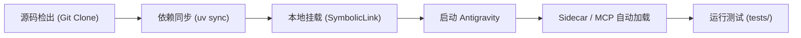

# Zotero in AG 插件开发与架构设计文档

> **插件名称**: Zotero in AG (Zotero Literature Hub for Google Antigravity)  
> **最新版本**: v2.3.0  
> **适用宿主**: Google Antigravity 2.0+ (桌面端 Electron 及 IDE 体系)  
> **运行环境**: Python >= 3.11, Astral `uv`, Zotero (7 / 8 / 9 / 10+)  
> **文档定位**: 插件开发者指南、系统架构设计、工程开发规范（更新日志详见 [CHANGELOG.md](CHANGELOG.md)）

---

## 1. 项目与插件定位

`Zotero in AG` 是专为 Google Antigravity 设计的学术文献插件，旨在打破传统 AI 编程/学术研究工具中“查文献需切屏、读论文需另开阅读器、AI 总结无法回流”的割裂体验。

- **AI 研读侧 (MCP JSON-RPC)**：使 Antigravity Agent 具备直接检索 Zotero 本地库、提取指定页码 PDF 纯文本、并将结构化精读报告回存为独立富文本笔记的原子能力。
- **视觉工作台侧 (Auxiliary Pane Webview)**：利用 Antigravity 的右侧副面板，通过 FastAPI 和本地离线 Mozilla PDF.js 提供极速、无极滚轮滚动、自适应宽度的论文阅读器与目录树管理工作台。
- **数据一致性与底层安全**：采用无锁（Non-locking SQLite）与本地 Local API 双轨架构，保障与 Zotero 桌面端（7/8/9/10+）高并发并存，彻底杜绝 Windows/macOS 上的文件锁冲突。

---

## 2. 插件构建与工程开发流程 (Build & Dev Workflow)



### 2.1 环境准备
本项目采用现代 Python 包管理工具 [uv](https://astral.sh/uv) 驱动，保证毫秒级环境解析与跨平台一致性。
```bash
# 1. 检出仓库代码
git clone https://github.com/<your-username>/zotero-in-ag.git
cd zotero-in-ag

# 2. 一键创建虚拟环境并锁定安装依赖
uv sync
```

### 2.2 本地插件挂载调试 (Symlink 安装)
无需频繁打包，直接通过软链接方式将开发仓库挂载至 Antigravity 全局插件加载目录：

- **Windows (PowerShell 管理员模式)**:
  ```powershell
  New-Item -ItemType Directory -Force -Path "$HOME\.gemini\config\plugins"
  New-Item -ItemType SymbolicLink -Path "$HOME\.gemini\config\plugins\zotero-in-ag" -Target "$PWD"
  ```
- **macOS / Linux**:
  ```bash
  mkdir -p ~/.gemini/config/plugins
  ln -s "$(pwd)" ~/.gemini/config/plugins/zotero-in-ag
  ```

### 2.3 调试与自动化测试执行
在本地开发任何功能后，均可通过 uv 快速运行内置的自动化集成验证套件：
```bash
# 验证核心层（数据库无锁直读、Storage 附件路径定位、PDF 文本提取）
uv run python tests/test_core.py

# 验证 MCP 协议层工具响应（检索、目录树、摘要、独立笔记接口）
uv run python tests/test_mcp.py

# 验证 Sidecar 预览侧边栏 API（FastAPI 端点、PDF 分块流传输）
uv run python tests/test_sidecar.py

# 验证 v2.2.0 安全准出合规性（CORS 拦截、路径穿越防御、离线 CMap、越界响应）
uv run python tests/test_v220_acceptance.py

# 验证 MCP 6 大工具 Golden Master 文本快照（确保 Diff = 0 契约绝对兼容）
uv run python tests/test_mcp_snapshot.py

# 验证 v2.3.0 模块化分层重构与 ESM 资产完整性
uv run python tests/test_v230_refactoring.py
```

---

## 3. 插件项目文件结构字典

```text
zotero-in-ag/
├── .gitignore                   # Git 忽略配置（严格排除 .venv、*.log 及临时缓存）
├── .python-version              # Python 运行版本约束文件 (3.11)
├── pyproject.toml               # uv/PEP 621 标准构建配置与依赖清单 (v2.3.0)
├── uv.lock                      # 跨平台依赖确定性锁文件
├── plugin.json                  # Antigravity 插件核心描述清单（名称、版本、Prompt 入口）
├── mcp_config.json              # Antigravity 内嵌 MCP 工具服务启动声明
├── README.md                    # 开源项目主页与快速上手说明
├── CHANGELOG.md                 # 插件全版本演进与发布日志 (SemVer 规范)
├── PROJECT_STRUCTURE.md         # 插件开发与架构设计文档（本文档）
├── LICENSE                      # MIT 开源许可证
├── assets/
│   └── logo.svg                 # 插件官方矢量图标（高对比度适配暗色/亮色主题）
├── rules/
│   └── AGENTS.md                # 注入 Antigravity 的学术助手常驻规则与胶囊格式
├── skills/
│   └── zotero/
│       └── SKILL.md             # /zotero 技能提示词、快捷入口与学术工作流约束
├── sidecars/
│   └── zotero-pane/
│       └── sidecar.json         # 声明 Auxiliary Pane 右侧副面板 Web 视图接入点
├── src/
│   ├── domain/                  # [v2.3.0] 领域数据契约与 Pydantic 强类型模型
│   │   ├── __init__.py          # 领域层导出标识
│   │   └── models.py            # LibraryItem, CollectionNode, Annotation 等领域契约
│   ├── services/                # [v2.3.0] 统一应用服务层（纯业务中枢）
│   │   ├── __init__.py          # 服务层导出标识
│   │   ├── catalog_service.py   # 文献检索、分类树组装、asyncio.to_thread 线程卸载
│   │   ├── document_service.py  # PDF 物理定位、流式传输安全断言、分页文本提取
│   │   ├── annotation_service.py# 批注服务端归一化合并、内存互斥锁与原子持久化
│   │   ├── translation_service.py # 查词、NMT 神经网络翻译、自定义 AI 模型调用
│   │   └── validation.py        # 8 位 Key 正则验证、SSRF 链路本地元数据白名单守卫
│   ├── core/                    # 基础设施与底层驱动
│   │   ├── __init__.py          # 模块导出标识
│   │   ├── config.py            # 跨平台数据目录/安装路径阶梯式智能探测（支持 prefs.js 与注册表嗅探）
│   │   ├── db.py                # SQLite 高性能只读驱动（mode=ro WAL 实时感知 + 退避重试）
│   │   ├── storage.py           # Zotero storage/ 物理 PDF 路径查找引擎（防路径穿越 + Linked Files 架构支持）
│   │   ├── pdf_extractor.py     # 基于 pypdf 的正文提取与安全字符守卫（规范化越界响应）
│   │   └── zotero_api.py        # 本地桌面端交互桥梁（统一异步写模型 + 同步适配器桥接）
│   ├── mcp_server/              # MCP 工具协议薄层
│   │   ├── __init__.py          # 模块导出标识
│   │   └── server.py            # 面向 Agent 暴露的 6 大原子学术工具（调用服务层并渲染 Markdown）
│   └── sidecar/                 # 预览副面板 Web 服务与前端应用
│       ├── __init__.py          # 模块导出标识
│       ├── server.py            # 纯薄路由：依赖调用、参数校验、HTTP 响应映射与 CORS
│       └── static/              # 前端原生 ES Modules 静态资源
│           ├── index.html       # 极简双栏布局（生产端加载带缓存穿透的自包含引擎 app.js?v=2.3.0.6）
│           ├── css/app.css      # 原生 Antigravity 图标适配、无极滚动与深色系样式
│           ├── js/              # [v2.3.0] 前端架构源码模块与生产运行时
│           │   ├── main.js      # 模块化装配入口（ESM 架构基准）
│           │   ├── state.js     # 响应式状态与 Settings 本地持久化
│           │   ├── api.js       # 后端 REST 接口通信封装
│           │   ├── viewer/      # 阅读器模块
│           │   │   ├── pdf_viewer.js # PDF.js 渲染管线、自适应缩放与视口惰性卸载
│           │   │   └── shield.js     # [核心资产] 几何测距投影与 .endOfContent 哨兵拦截
│           │   ├── annotations/ # 批注标记模块
│           │   │   └── layer.js      # 8 色高亮与下划线渲染、拾取与只读安全守护
│           │   ├── ui/          # 用户交互模块
│           │   │   ├── tooltip.js    # 划词浮动工具栏、AI 释义与 Agent 提问交互
│           │   │   └── settings.js   # 外观换肤、自定义模型与提示词面板
│           │   ├── app.js       # 生产自包含运行时引擎（防 Electron 沙箱网络挂起与 Null 引用保护）
│           │   └── app.legacy.js# 原单体巨石备份（秒级回退保障）
│           └── vendor/pdfjs/    # 离线 Mozilla PDF.js 核心库与 169 份 CMap 字体资源
└── tests/                       # 单元与集成测试套件
    ├── fixtures/                # [v2.3.0] 脱机测试夹具与合成 SQLite 生成器
    │   └── mock_zotero.py       # 最小 Schema 合成数据库与虚拟 PDF 生成器
    ├── snapshots/               # [v2.3.0] 黄金快照基线库
    │   └── mcp_golden_snapshots.json # 6 大 MCP 工具 Markdown 格式黄金快照
    ├── test_core.py             # 核心数据库与存储读取测试
    ├── test_mcp.py              # MCP 工具层调用功能测试（动态条目解耦）
    ├── test_mcp_snapshot.py     # [v2.3.0] 黄金快照比对测试（Diff = 0 校验）
    ├── test_sidecar.py          # FastAPI 接口与 PDF 流传输测试（防御性测试）
    ├── test_v220_acceptance.py  # v2.2.0 安全与准出验证专用套件
    └── test_v230_refactoring.py # [v2.3.0] 模块化分层重构与 ESM 验证套件
```

---

## 4. 核心关键技术与架构设计

### 4.1 操作系统级 SQLite 无锁并发与弹性降级机制 (`src/core/db.py`)
- **问题背景**：在 Windows 系统下，SQLite 在 WAL 模式下需要通过共享内存文件（`-shm`）协调锁。当 Zotero 桌面端启动时，Gecko 引擎可能会持有 `PRAGMA main.locking_mode=EXCLUSIVE` 排他锁。如果外部 Python 后台持有连接未释放，或直接使用普通只读连接，会导致 `database is locked` 错误（阻塞 15 秒超时抛出 HTTP 500），进而导致侧边栏卡在“检测连接中”且目录空白。
- **工程设计与双阶段降级**：
  1. **首选阶段（WAL 实时可见）**：连接 URI 优先采用 `?mode=ro`（超时 0.6 秒）。在 Zotero 未持有独占锁时，保证新条目与未提交 WAL 帧的即时可见性。
  2. **容灾降级（锁定自动回退）**：若在 0.6 秒内捕获到 `locked` 锁定异常，立即自动回退至 `?mode=ro&immutable=1` URI 模式。该参数通知 SQLite 底层跳过所有文件锁和 shared-memory 映射，确保侧边栏高并发查询以 <10ms 极速响应，保证服务永不宕机。
  3. **连接瞬时释放**：采用 Python `@contextmanager` 上下文管理器，所有 SQL 查询执行完成后在 `finally` 块内执行 `conn.close()`，彻底交还操作系统文件句柄。

### 4.2 连续滚轮滚动与自适应宽度 PDF 阅读器 (`src/sidecar/static/js/app.js`)
- **平滑阅读**：抛弃传统只能“点击翻页”的生硬交互，采用连续页面 DOM 布局。
- **惰性视口渲染 (IntersectionObserver)**：仅对进入视口范围（加上前后各 1 页缓冲区）的页面执行 `page.render()`，页面滚出视口后自动清空 Canvas 像素，确保上百页文献平稳流畅、无内存泄漏。
- **自动适应宽度 (Fit Width)**：监听窗口与侧边栏的 `ResizeObserver`，动态依据可用容器宽度计算缩放比 `scale`，并实时将缩放百分比同步回工具栏胶囊。

### 4.3 方案 A：独立富文本笔记持久化
- **学术规范**：不篡改科研人员的原始 PDF 文件批注层。
- **双向协同**：通过调用本地 Zotero 7/8/9/10+ 提供的 Local API（`POST /api/users/0/items`），将 Antigravity Agent 精读生成的 Markdown 报告转化为语义化 HTML，作为文献条目下的独立 Rich-text Note 子笔记持久化存储，桌面端即时刷新。

### 4.4 跨平台无缝适配策略
- **路径探测**：按“环境变量 $\to$ 系统标准默认（`~/Zotero`） $\to$ 自定义路径”阶梯探测。
- **Sidecar 相对工作目录执行**：`sidecar.json` 采用 `--directory ../..` 通用相对路径，解决 Antigravity 默认将 `cwd` 置于子目录所导致的 `exit status 2`（模块找不到）问题，确保任何克隆路径均可直接启动。
- **系统调用解耦**：桌面端定位条目兼容 Windows（`os.startfile`）、macOS（`open`）与 Linux（`xdg-open`），彻底杜绝跨平台运行异常。

### 4.5 动态选区护盾机制 (Selection Shield / endOfContent)
- **绝对定位与留白虚空**：PDF.js 的 TextLayer 并非流式排版，而是离散的绝对定位 Span。行尾留白与段间距在 DOM 中无元素占位，鼠标稍出单词便会引发 Chromium 选区向后穿透导致跳选。
- **Zotero 同款动态拦截**：文字 Span 设置 `z-index: 1`，底层注入全页覆盖的 `endOfContent` 守卫元素（`z-index: 0`）。在 `selectionchange` 期间动态将守卫插在当前激活词节点的 `nextSibling`，鼠标一进留白立即被护盾拦截，彻底锁死选区终点；释放鼠标后平滑复位。

### 4.6 前端双轨设计与源码/生产引擎同步规范
- **为什么生产加载 `app.js` 而非原生 ESM**：Antigravity 侧边栏为 Electron Webview 沙箱环境。直接使用 `<script type="module">` 进行多文件相对路径异步加载时，易遭遇 Chromium 跨源沙箱隔离、子模块请求挂起与模块语法缓存问题（导致出现“检测连接中/目录为空/无法打开设置”）。因此生产端以高度稳健、零网络跳跃的 `app.js?v=2.3.0.6` 作为执行引擎。
- **模块化源码的定位**：`src/sidecar/static/js/` 下的 8 个 ESM 模块（`state.js`, `api.js`, `viewer/`, `annotations/`, `ui/`, `main.js`）是系统的“架构真理来源”，职责分明、语法规范，供开发者阅读、单元测试及打包构建。
- **同步工作流与工具**：提供了构建校验脚本 `scripts/bundle_frontend.py`（以及测试套件 `test_v230_refactoring.py`），当更新前端逻辑时，可运行脚本自动校验模块一致性与生产引擎语法，确保双轨无逻辑漂移。

---

## 5. 项目版本与更新日志 (Version History)

> 详细的版本演进记录、新特性清单、架构优化与 Bug 修复历史，请统一参阅独立的更新日志文件：  
> 📄 **[CHANGELOG.md](CHANGELOG.md)**

---

## 6. 后续迭代规划 (Roadmap)

- [ ] **语义向量检索**：基于本地嵌入模型，为 Zotero 论文库构建向量索引，支持跨文献的语义概念检索。
- [ ] **多篇论文横向对比**：在侧边栏支持多 Tab 或双栏对比模式，便于横向比对不同实验结论。
- [ ] **BibTeX 一键导出与 LaTeX 联动**：在 Antigravity 编写论文代码时，支持由 Agent 自动补全 `.bib` 文件条目。
